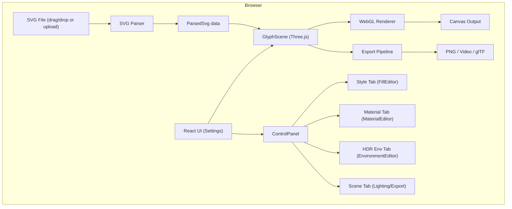
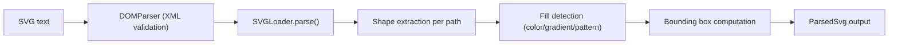
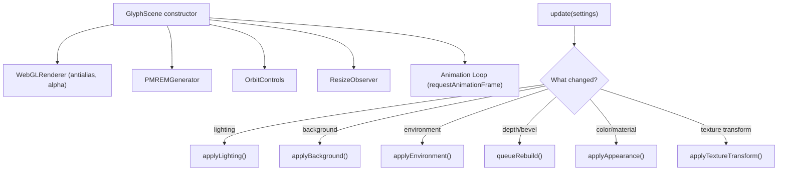
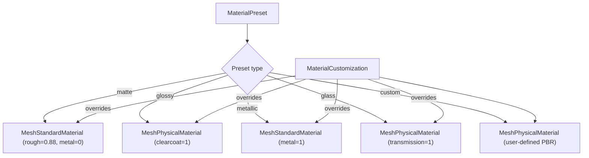
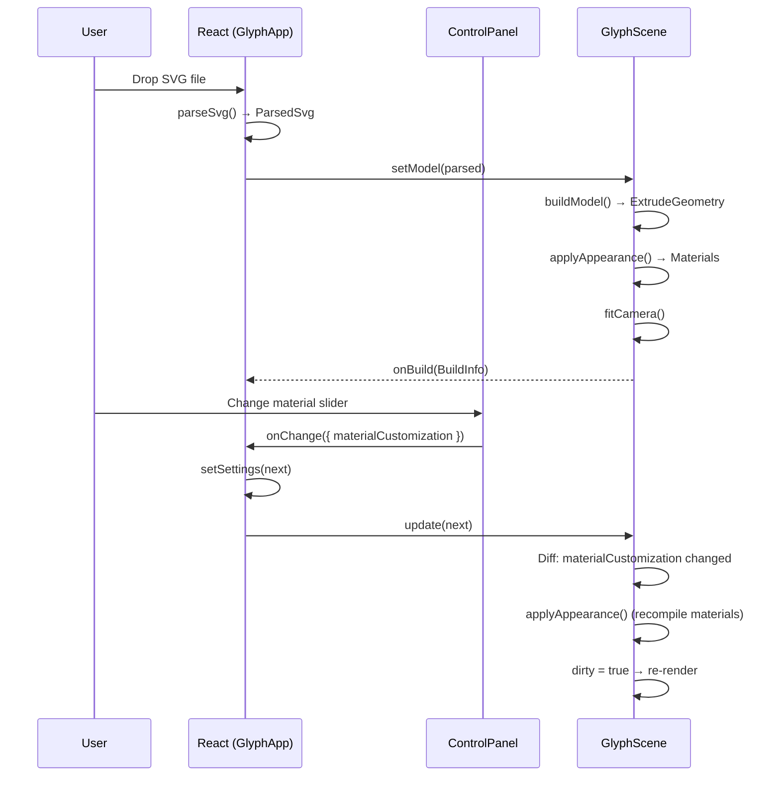
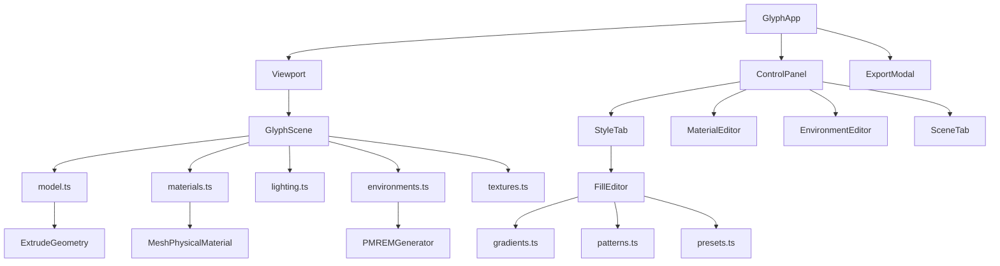

# Glyph — System Design & Architecture Documentation

> **Glyph** is a real-time, in-browser framework for converting flat SVG artwork into production-quality 3D models with physically-based rendering (PBR), HDR environment lighting, and multi-format export.

---

## Table of Contents

1. [High-Level Architecture](#1-high-level-architecture)
2. [Technology Stack](#2-technology-stack)
3. [Project Structure](#3-project-structure)
4. [Module Walkthrough](#4-module-walkthrough)
   - [Entry Point & Framework](#41-entry-point--framework)
   - [SVG Parsing Pipeline](#42-svg-parsing-pipeline)
   - [3D Scene Engine](#43-3d-scene-engine)
   - [Model Builder](#44-model-builder)
   - [Materials System](#45-materials-system)
   - [Lighting System](#46-lighting-system)
   - [HDR Environment System](#47-hdr-environment-system)
   - [Fill Modes (Color/Gradient/Texture)](#48-fill-modes)
   - [Export Pipeline](#49-export-pipeline)
   - [UI Components](#410-ui-components)
5. [Data Flow](#5-data-flow)
6. [Type System & Settings Model](#6-type-system--settings-model)
7. [Performance Architecture](#7-performance-architecture)
8. [Dependencies](#8-dependencies)
9. [Build & Development](#9-build--development)
10. [Deployment](#10-deployment)

---

## 1. High-Level Architecture



**React owns settings; Three.js owns the GPU.** The application follows a unidirectional data flow:

1. **User actions** produce `GlyphSettings` patches via React state
2. **GlyphScene** receives the new settings through its `update()` method
3. **Diff-based updates** — only changed properties trigger GPU work
4. **Render-on-demand** — the animation loop only draws when something changed

---

## 2. Technology Stack

| Layer | Technology | Version | Purpose |
|-------|-----------|---------|---------|
| **Framework** | Astro | ^5.13.0 | Static site generation, routing, HTML shell |
| **UI** | React | ^19.1.0 | Component state management, declarative UI |
| **3D Engine** | Three.js | ^0.170.0 | WebGL rendering, PBR materials, PMREM environment maps |
| **Styling** | Tailwind CSS | ^4.1.0 | Utility-first CSS with custom design tokens |
| **Language** | TypeScript | ^5.6.0 | Type safety across all modules |
| **Bundler** | Vite (via Astro) | — | Dev server, HMR, tree-shaking, code splitting |

### Key Three.js Sub-modules Used

| Import | Purpose |
|--------|---------|
| `OrbitControls` | Camera orbit, zoom, pan with mouse/touch |
| `SVGLoader` | Parse SVG path data into Three.js `Shape` objects |
| `RGBELoader` | Load Radiance `.hdr` equirectangular environment maps |
| `PMREMGenerator` | Pre-filter environment maps for real-time reflections |
| `RoomEnvironment` | Procedural studio lighting environment |
| `GLTFExporter` | Export 3D scene to glTF 2.0 format |
| `toCreasedNormals` | Smooth shading while preserving hard edges |
| `ExtrudeGeometry` | Convert 2D shapes into 3D geometry with depth and bevel |
| `MeshPhysicalMaterial` | Advanced PBR material with clearcoat, transmission, IOR |

---

## 3. Project Structure

```
glyph/
├── public/                     # Static assets served as-is
│   ├── favicon.svg             # Application logo favicon
│   └── hdr preset/             # Bundled local high-dynamic-range environment maps
│       ├── studio.hdr          # Photo studio lighting
│       ├── park.hdr            # Outdoor park daylight
│       ├── sunset.hdr          # Warm golden hour horizon
│       └── night.hdr           # City nocturnal atmosphere
├── docs/
│   └── Glyph_PRD.pdf           # Product Requirements Document
├── src/
│   ├── assets/
│   │   └── sample-logo.svg     # Built-in sample SVG artwork
│   ├── components/
│   │   ├── GlyphApp.tsx        # Root application component (state, drag/drop, export)
│   │   ├── Viewport.tsx        # React wrapper around GlyphScene (lazy-loaded)
│   │   ├── ControlPanel.tsx    # 4-tab sidebar: Style, Material, HDR Env, Scene
│   │   ├── FillEditor.tsx      # Color mode editor (Original/Solid/Gradient/Texture)
│   │   ├── MaterialEditor.tsx  # PBR material customization sliders
│   │   ├── EnvironmentEditor.tsx # HDR environment selection & tuning
│   │   ├── ExportModal.tsx     # Export dialog (PNG/Video/glTF)
│   │   ├── icons.tsx           # SVG icon components (Lucide-style)
│   │   └── ui.tsx              # Design system primitives (Button, Slider, etc.)
│   ├── layouts/
│   │   └── Layout.astro        # HTML shell with meta, fonts, theme script
│   ├── lib/
│   │   ├── scene.ts            # GlyphScene class — imperative Three.js controller
│   │   ├── types.ts            # All TypeScript types, interfaces, and defaults
│   │   ├── svgParser.ts        # SVG → ParsedSvg pipeline
│   │   ├── model.ts            # Shape → extruded 3D mesh builder
│   │   ├── materials.ts        # PBR material factory (presets + customization)
│   │   ├── lighting.ts         # Light rig presets (studio, soft, dramatic)
│   │   ├── environments.ts     # HDR environment definitions & procedural scenes
│   │   ├── gradients.ts        # SVG gradient compiler & user gradient paint
│   │   ├── patterns.ts         # Procedural 2D texture patterns (checker, etc.)
│   │   ├── textures.ts         # Canvas texture creation & image loading
│   │   ├── presets.ts          # Built-in swatches, gradient presets, pattern defs
│   │   └── constants.ts        # File size limits, SVG detection
│   ├── pages/
│   │   └── index.astro         # Single page (renders GlyphApp)
│   ├── styles/
│   │   └── global.css          # Design tokens, Tailwind config, custom slider/checker
│   └── env.d.ts                # Vite environment type declarations
├── package.json
├── tsconfig.json
└── astro.config.mjs
```

---

## 4. Module Walkthrough

### 4.1 Entry Point & Framework

**`src/pages/index.astro`** → **`src/layouts/Layout.astro`** → **`src/components/GlyphApp.tsx`**

Astro serves a single static page. The `Layout.astro` component provides the HTML shell with:
- Meta tags & SEO
- Google Fonts (Inter)
- Theme detection script (prevents FOUC)
- Global CSS import

`GlyphApp.tsx` is the React root, hydrated client-side (`client:only="react"`). It owns:
- **All application state** via `useState<GlyphSettings>`
- **File I/O**: SVG upload, drag-and-drop (SVG, images, HDR files)
- **Export orchestration**: PNG, Video, and glTF export workflows
- **Theme toggle**: light/dark mode with `localStorage` persistence
- **Error handling**: toast notifications, error banners
- **Export modal**: `ExportModal` component with format-specific options

### 4.2 SVG Parsing Pipeline

**File**: [`src/lib/svgParser.ts`](file:///i:/Project/glyph/src/lib/svgParser.ts)



**Key decisions:**
- **Security**: SVG is parsed as XML but never inserted into the DOM, preventing script execution
- **Fill handling**: Flat colors are kept as `Color` objects; `url()` references are compiled into `PaintServer` objects via `gradients.ts`
- **Unsupported fills**: `<pattern>` and other non-gradient paints are rendered in a neutral gray
- **Error messages**: User-friendly errors via `GlyphError` class (e.g., stroke-only SVGs get a specific message about converting to outlines)

### 4.3 3D Scene Engine

**File**: [`src/lib/scene.ts`](file:///i:/Project/glyph/src/lib/scene.ts) — `GlyphScene` class (972 lines)

This is the core imperative controller. React communicates with it through two methods:

| Method | Purpose |
|--------|---------|
| `setModel(parsed)` | Load or clear the 3D artwork |
| `update(settings)` | Apply new settings (diff-based) |

**Internal architecture:**



**Key features:**
- **Render-on-demand**: The tick function only calls `renderer.render()` when `dirty` is true or the orbit controls moved
- **Material caching**: Materials are keyed by their configuration string and reused, avoiding shader recompilation
- **Coalesced rebuilds**: Slider drags are coalesced into one rebuild per frame via `requestAnimationFrame`
- **GPU context recovery**: Handles `webglcontextlost`/`webglcontextrestored` events
- **Environment caching**: Loaded HDR environment maps are cached by key to avoid re-downloading

### 4.4 Model Builder

**File**: [`src/lib/model.ts`](file:///i:/Project/glyph/src/lib/model.ts)

Converts `ParsedSvg` shapes into extruded 3D meshes:

1. Each SVG path becomes its own `ExtrudeGeometry` with configurable depth and bevel
2. **Bevel offset is negative** — caps shrink inward instead of growing outward, preventing collisions between neighboring shapes
3. **Z-fighting prevention**: Later paths are stacked slightly forward (`layerStep`)
4. **Creased normals**: `toCreasedNormals()` smooths curved surfaces while keeping 35° hard edges
5. **Normalization**: The artwork's longest side is scaled to `MODEL_SIZE` (10 scene units)
6. **Y-axis flip**: SVG's y-down coordinate system is flipped to Three.js's y-up

**UV Generation**: UVs are generated lazily via `setPlanarUV()` only when a texture fill mode is active, saving GPU memory for solid/gradient fills.

### 4.5 Materials System

**File**: [`src/lib/materials.ts`](file:///i:/Project/glyph/src/lib/materials.ts)



**Material Customization Properties:**

| Property | Range | Default | Description |
|----------|-------|---------|-------------|
| `roughness` | 0–1 | 0.5 | Mirror-smooth → fully diffuse |
| `metalness` | 0–1 | 0.0 | Dielectric → full metal |
| `clearcoat` | 0–1 | 0.0 | Lacquer layer intensity (car paint) |
| `clearcoatRoughness` | 0–1 | 0.1 | Clearcoat surface roughness |
| `transmission` | 0–1 | 0.0 | Glass-like see-through transparency |
| `opacity` | 0–1 | 1.0 | Overall surface opacity |
| `ior` | 1.0–2.5 | 1.5 | Index of refraction for glass |
| `reflectivity` | 0–2 | 0.5 | Environment reflection intensity |

**Preset switching** seeds the customization sliders with the preset's base values via `getPresetValues()`.

### 4.6 Lighting System

**File**: [`src/lib/lighting.ts`](file:///i:/Project/glyph/src/lib/lighting.ts)

Three presets that configure direct lights and environment intensity:

| Preset | Key Light | Fill/Ambient | Environment Intensity |
|--------|----------|-------------|----------------------|
| **Studio** | White directional (2.4) + fill (0.9) + rim (1.6) | Ambient (0.25) | 0.9 |
| **Soft** | Hemisphere (1.4) + soft directional (0.9) | — | 1.3 |
| **Dramatic** | Hard side key (4.0) + colored violet rim (2.2) | Dim ambient (0.05) | 0.25 |

The `envIntensity` multiplier modulates how strongly the HDR environment map influences reflections and indirect lighting.

### 4.7 HDR Environment System

**Files**: [`src/lib/environments.ts`](file:///i:/Project/glyph/src/lib/environments.ts) + [`src/components/EnvironmentEditor.tsx`](file:///i:/Project/glyph/src/components/EnvironmentEditor.tsx)

**Built-in environments** organized into 5 categories:

| ID | Name | Type | Source / Path | Category |
|----|------|------|---------------|----------|
| `studio` | Photo Studio | Local HDR | `/hdr preset/studio.hdr` | Studio |
| `park` | Green Park | Local HDR | `/hdr preset/park.hdr` | Outdoor |
| `sunset` | Golden Sunset | Local HDR | `/hdr preset/sunset.hdr` | Sunset |
| `night` | City Night | Local HDR | `/hdr preset/night.hdr` | Night |
| `cyberpunk` | Cyberpunk Neon | Procedural | Three.js Procedural Scene | Stylized |

**Local HDR Environments**: Bundled directly in `public/hdr preset/` (`studio.hdr`, `park.hdr`, `sunset.hdr`, `night.hdr`) for zero-latency, offline-capable instant loading without external CDN dependencies or network latency.

**Procedural environments** (`cyberpunk`) are generated client-side using Three.js geometry and emissive materials — no network required.

**Resilient Fallback**: If an HDR file fails to decode, the engine automatically falls back to Three.js `RoomEnvironment` to prevent unlit models.

**Custom HDRI**: Users can upload their own `.hdr` files or equirectangular panorama images.

**Environment Tuning Controls:**
- Lighting intensity (0%–300%)
- Environment rotation (0°–360°)
- Show HDR as viewport background (toggle)
- Background blur (0%–100%)
- Background brightness (0%–300%)

### 4.8 Fill Modes

**File**: [`src/components/FillEditor.tsx`](file:///i:/Project/glyph/src/components/FillEditor.tsx)

Four mutually exclusive color modes:

| Mode | Description | Implementation |
|------|-------------|----------------|
| **Original** | Each path keeps its SVG fill | Per-path materials with original colors |
| **Solid** | Single color for all paths | Shared material with `color.set()` |
| **Gradient** | User-editable multi-stop gradient | Per-vertex colors via `applyPaint()` |
| **Texture** | Pattern or uploaded image | UV projection + `CanvasTexture` |

**Gradient system** (`gradients.ts`):
- Supports both linear and radial gradients
- Multi-stop (2–5 stops) with interactive color + offset editing
- SVG gradients are compiled into `PaintServer` objects that can be sampled at any coordinate
- Colors are interpolated in sRGB space, then converted to linear for Three.js

**Texture system** (`textures.ts`, `patterns.ts`):
- 7 procedural patterns: checker, stripes, dots, grid, grain, marble, wood
- All generated on `<canvas>` at 512×512 using tileable value noise
- User-uploaded images are downscaled to 2048px max side
- Textures have full transform controls: repeat, rotation, offset X/Y

### 4.9 Export Pipeline

**Exports are handled in `GlyphScene`** with three output formats:

#### PNG Export (`exportPng`)
1. Scale renderer to desired resolution (1× or 2×)
2. If transparent mode: set `scene.background = null` and `clearColor(0, 0)` — reflections and lighting remain on the 3D object
3. Render single frame
4. `canvas.toBlob()` in the same task (no `preserveDrawingBuffer` needed)
5. Restore renderer state

#### Video Export (`exportVideo`)
1. Capture `MediaStream` from canvas
2. Initialize `MediaRecorder` with preferred codec (VP9 → VP8 → WebM)
3. Animate 360° turntable rotation over the specified duration
4. Report progress via callback
5. Stop recorder and assemble `Blob` from chunks
6. Supports transparent background via WebM alpha channel

#### glTF Export (`exportGltf`)
1. Dynamically import `GLTFExporter`
2. Export scene root with embedded images
3. Supports binary `.glb` (recommended) and JSON `.gltf` formats
4. Includes full 3D geometry, PBR materials, bevel, and extrusion depth

### 4.10 UI Components

**File**: [`src/components/ui.tsx`](file:///i:/Project/glyph/src/components/ui.tsx)

Custom design system built on Tailwind CSS:

| Component | Purpose |
|-----------|---------|
| `Button` | Multi-variant button (default, outline, ghost, secondary) |
| `Slider` | Range input with label, value display, and filled track |
| `Segmented` | Radio group rendered as tab-like pills |
| `Switch` | Toggle with accessible `role="switch"` |
| `ColorInput` | Color swatch + hex text input with validation |
| `Swatches` | Preset color palette row |
| `Field` | Label + hint layout wrapper |
| `Group` | Section with title and border separator |
| `Tile` | Selectable preview tile (gradients, patterns) |

All components are touch-optimized with ≥40px touch targets on mobile.

---

## 5. Data Flow



### Settings Diff Algorithm

The `update()` method compares previous and next settings to minimize GPU work:

```
lighting changed?        → applyLighting() (rebuild light rig)
background changed?      → applyBackground() (set clear color)
environment.id changed?  → applyEnvironment() (load/cache PMREM)
environment props only?  → updateEnvironmentProperties() (intensity, rotation, blur)
depth/bevel changed?     → queueRebuild() (re-extrude all geometry)
colorMode/material/cust? → applyAppearance() (recompile materials)
solid color only?        → updateSolidColor() (in-place Color.set)
gradient stops only?     → rebakeGradient() (in-place vertex colors)
texture source changed?  → applyAppearance() (full texture reload)
texture transform only?  → applyTextureTransform() (offset/rotation)
```

---

## 6. Type System & Settings Model

**File**: [`src/lib/types.ts`](file:///i:/Project/glyph/src/lib/types.ts)

The central `GlyphSettings` interface captures the entire application state:

```typescript
interface GlyphSettings {
  colorMode: ColorMode;          // 'original' | 'solid' | 'gradient' | 'texture'
  solidColor: string;            // #rrggbb
  gradient: GradientSettings;    // type, stops[], angle
  texture: TextureSettings;      // source, pattern, image, transform
  material: MaterialPreset;      // 'matte' | 'glossy' | 'metallic' | 'glass' | 'custom'
  materialCustomization: MaterialCustomization; // roughness, metalness, clearcoat, etc.
  lighting: LightingPreset;      // 'studio' | 'soft' | 'dramatic'
  environment: EnvironmentSettings;  // id, intensity, rotation, background
  export: ExportSettings;        // format, scale, transparency, fps, duration
  depth: number;                 // extrusion depth (% of longest side)
  bevel: number;                 // bevel amount (0–100)
  background: string;            // viewport background color
  transparentBackground: boolean;
}
```

**Defaults** are defined as constants (`DEFAULT_SETTINGS`, `DEFAULT_ENVIRONMENT`, `DEFAULT_MATERIAL_CUSTOMIZATION`, etc.) ensuring a consistent starting state.

---

## 7. Performance Architecture

| Technique | Implementation |
|-----------|---------------|
| **Render-on-demand** | Animation loop skips `renderer.render()` when nothing changed |
| **Material caching** | Materials keyed by configuration string, reused across rebuilds |
| **Coalesced rebuilds** | `requestAnimationFrame` debouncing for slider drags |
| **Lazy loading** | Three.js loaded via dynamic import; parser prefetched on idle |
| **Code splitting** | Vite splits into ~8 chunks (three.js, scene, UI, gradients, etc.) |
| **Texture downscaling** | User images capped at 2048px; anisotropy capped at 8× |
| **Pixel ratio capping** | `devicePixelRatio` capped at 2× to avoid GPU overload |
| **Environment caching** | PMREM-filtered env maps cached by key |
| **GPU context recovery** | Handles `webglcontextlost`/`webglcontextrestored` |
| **Object URL cleanup** | Texture and HDR URLs revoked on component unmount |

---

## 8. Dependencies

### Runtime Dependencies

| Package | Version | Purpose |
|---------|---------|---------|
| `astro` | ^5.13.0 | Static site generator, dev server, build tool |
| `@astrojs/react` | ^4.3.0 | React integration for Astro |
| `react` | ^19.1.0 | UI component framework |
| `react-dom` | ^19.1.0 | React DOM renderer |
| `three` | ^0.170.0 | 3D rendering engine (WebGL) |
| `tailwindcss` | ^4.1.0 | Utility-first CSS framework |
| `@tailwindcss/vite` | ^4.1.0 | Tailwind CSS Vite plugin |

### Dev Dependencies

| Package | Version | Purpose |
|---------|---------|---------|
| `typescript` | ^5.6.0 | TypeScript compiler |
| `@types/react` | ^19.1.0 | React type definitions |
| `@types/react-dom` | ^19.1.0 | React DOM type definitions |
| `@types/three` | ^0.170.0 | Three.js type definitions |

### Notable: No Dependencies

Glyph intentionally avoids:
- **State management libraries** (Redux, Zustand) — React `useState` is sufficient
- **UI component libraries** (shadcn, MUI) — custom lightweight primitives
- **Animation libraries** — native CSS transitions + `requestAnimationFrame`
- **Router** — single-page application with one route

---

## 9. Build & Development

```bash
# Install dependencies
npm install

# Start development server (hot reload)
npm run dev

# Type-check (sync Astro types + tsc)
npm run typecheck

# Production build (static output to dist/)
npm run build

# Preview production build locally
npm run preview
```

### Build Output

The production build generates static files in `dist/`:
- `index.html` — single page
- `_astro/` — hashed JS/CSS chunks
- Total JS: ~912 KB (gzipped: ~258 KB)
  - `three.js` chunk: ~604 KB (gzip: ~158 KB)
  - `GlyphApp` chunk: ~64 KB (gzip: ~19 KB)
  - `scene` chunk: ~18 KB (gzip: ~6 KB)

---

## 10. Deployment

Glyph is a fully static site with no server-side requirements:

- **Vercel**: `npm run build` → deploy `dist/`
- **Netlify**: Build command `npm run build`, publish directory `dist`
- **GitHub Pages**: Push `dist/` to `gh-pages` branch
- **Any static host**: Upload the `dist/` directory

No API keys, databases, or backend services are needed. Everything runs entirely in the user's browser.

---

## Component Relationship Diagram


